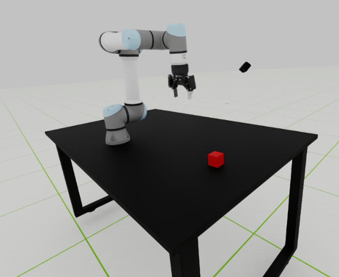
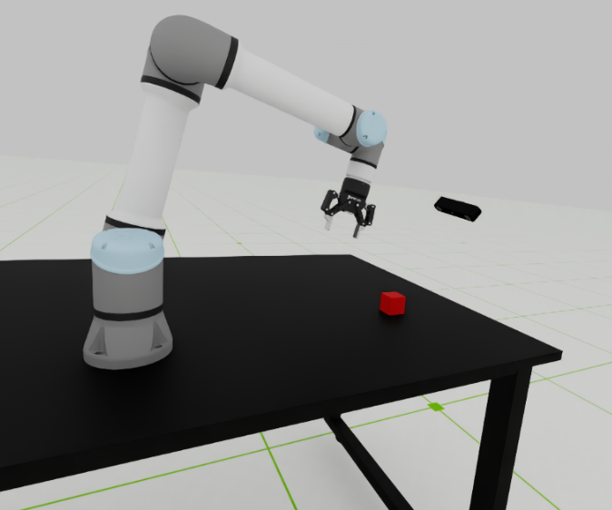
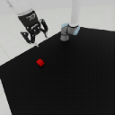
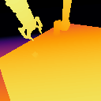
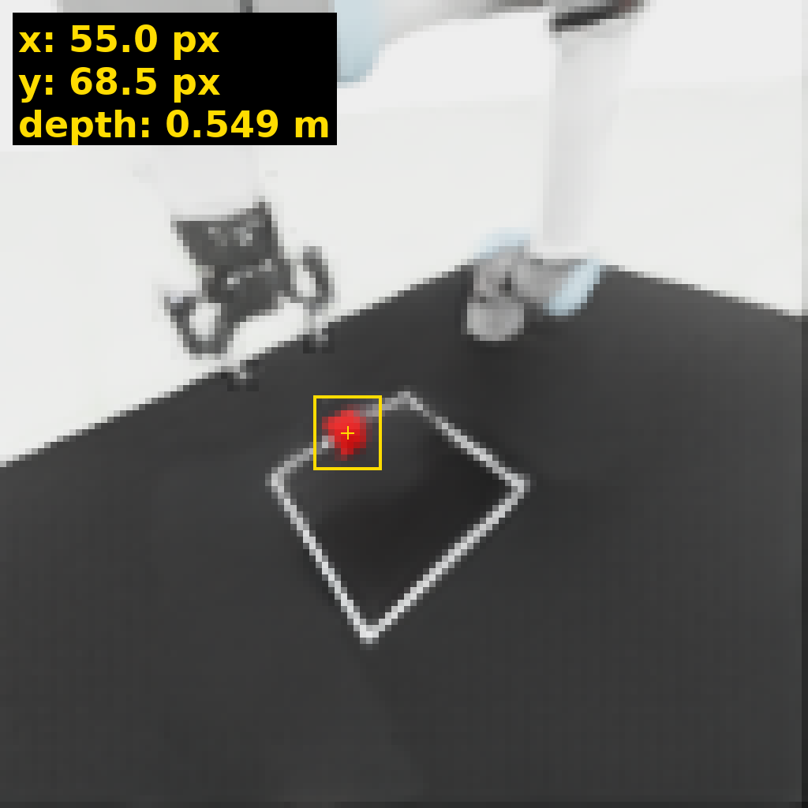
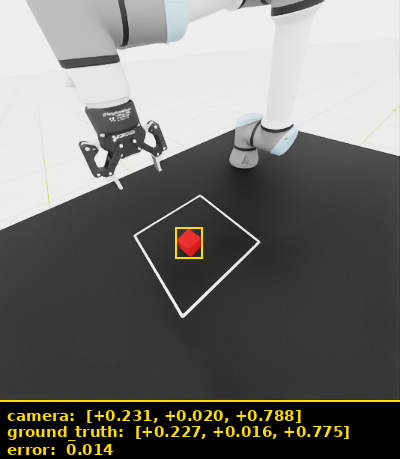
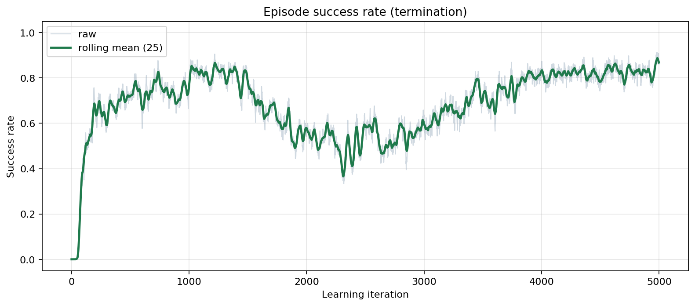
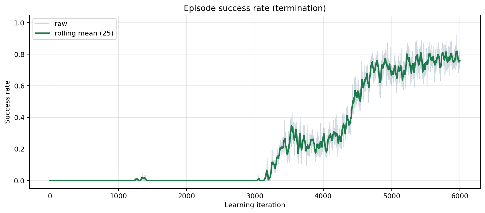
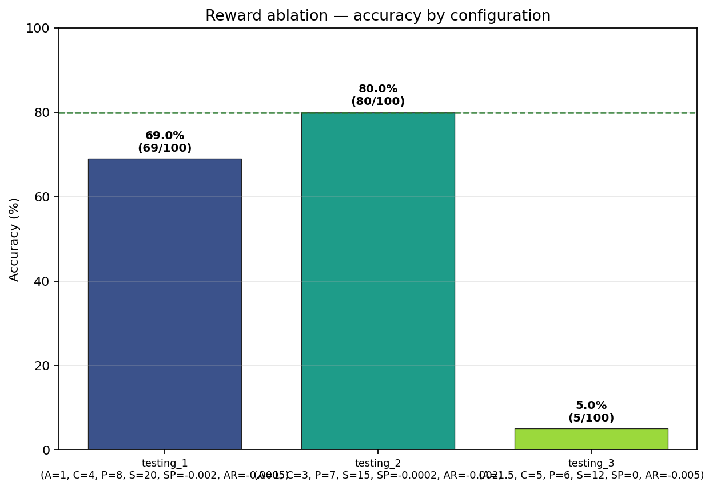

# Learning by Seeing and Doing: Vision-Based Reinforcement Learning for Robotic Arm Manipulation

Master's thesis research project
**Author:** Mohammad Amman  

## Overview

This repository implements an experimental framework for investigating how visual observation representations and reward-weight configurations influence reinforcement learning (RL) for robotic arm manipulation. Policies are trained using Proximal Policy Optimization (PPO) in NVIDIA Isaac Sim and Isaac Lab, within a simulated digital twin of the LUT robotic laboratory.

The research compares learning directly from RGB-D images, learning from compact object detection and depth observations, and training with simulator ground-truth object coordinates before replacing them with camera-estimated coordinates at evaluation time. Two manipulation tasks are used to investigate the effects of task complexity, observation representation and reward design on learning and task performance.

<p align="center">
  
  
</p>

## Research objectives

- Compare the effects of different observation representations on policy training and manipulation performance.
- Investigate the effect of replacing ground-truth object coordinates with camera-estimated coordinates after training, without retraining the policy.
- Examine how reward-weight configurations influence learning behaviour and task success.
- Compare the evaluated approaches across cube-moving and cube-picking tasks.

## Simulation and control framework

| Component | Configuration |
| --- | --- |
| Robotic manipulator | Universal Robots UR5e |
| Gripper | Robotiq 2F-85 |
| Perception sensor | Stereolabs ZED X RGB-D camera |
| Target object | Red cube, 5 cm side length |
| Simulation | NVIDIA Isaac Sim 6.0.1 (thesis experiments) |
| RL framework | NVIDIA Isaac Lab 3.0.0 |
| Learning algorithm | PPO (RSL-RL) |
| Camera image resolution | 128 × 128 pixels |

Curriculum-based randomization gradually expands the initial cube spawning region during training, up to ±15 cm along the X and Y axes (a 30 × 30 cm region).

The policy generates continuous target-position actions for the six UR5e joints and binary opening/closing commands for the gripper. Joint targets are scaled by 0.35 relative to the default joint configuration.

The observation framework separates the actor (policy), which selects actions, from the critic, which estimates value during training. In the visual approaches, the critic receives additional privileged information, including the simulator's true cube position. Robot-state observations include joint positions and velocities, with gripper position and previous actions included depending on the environment.

## Manipulation tasks

### Task 1 — Move Cube

The robot learns to approach the cube, establish valid finger contact and move it a short distance across the table. The registered implementation uses a displacement threshold of at least 1 cm in the XY plane.

The reward function combines approach, contact, pushing and task-success rewards with step and action-rate penalties.

### Task 2 — Pick Cube

The robot learns to reach the cube, grasp it, lift it and transport it to a predefined target position. The task requires maintaining a stable grasp while moving toward the goal.

The reward function encourages reaching, grasping, lifting/goal-directed movement and task completion, while penalizing rapid action changes, excessive joint velocities and dropping the cube.

## Observation approaches

### Method 1 — Raw RGB-D observation

The policy receives 128 × 128 RGB and depth images together with robot-state observations. A convolutional neural network (CNN) extracts visual features, which are combined with robot-state information before action prediction. No explicit cube position is calculated from the image for the actor.

<p align="center">
  
  
</p>

### Method 2 — Object detection and depth observation

A colour-based OpenCV detector identifies the red cube and computes its bounding box. The visual observation consists of the horizontal and vertical coordinates of the bounding-box centre and the corresponding depth value. Depth is estimated using the median of a 5 × 5 pixel window around the centre and normalized to the range [0, 1].

These compact features are supplied to the policy alongside robot-state information during both training and evaluation. Unlike Method 1, the policy does not need a CNN to learn visual features from full images.

<p align="center">
  
</p>

### Method 3 — Post-training detection

The policy is initially trained using the cube's Cartesian position (X, Y, Z) obtained directly from the simulator, expressed relative to the environment origin. Camera-based localization is not required during training.

During evaluation, the ground-truth cube position supplied to the actor is replaced with a camera-estimated position while retaining the trained policy and its observation representation. No policy retraining is performed.

The localization pipeline:

1. Detect the red cube in the RGB image and obtain its representative pixel coordinates.
2. Obtain the corresponding depth measurement.
3. Back-project the pixel and depth into 3D camera coordinates using camera intrinsics.
4. Apply a correction for the difference between the visible cube surface and its centre.
5. Transform the estimated position into the world frame using the camera pose, then into the local RL environment frame.
6. Supply the resulting Cartesian coordinates to the trained policy.

The gripper position in simulation is calculated from the midpoint of the two finger-pad positions. A physical implementation would require equivalent gripper coordinates, for example from forward kinematics; physical deployment was not evaluated in this thesis.

<p align="center">
  
</p>

## Registered environments

| Gym environment ID | Task | Observation / purpose |
| --- | --- | --- |
| `ThesisRl-Move-Cube-UR5E` | Move Cube | Raw RGB-D (Method 1) |
| `ThesisRl-Move-Cube-Detection-UR5E` | Move Cube | Bounding-box centre and depth (Method 2) |
| `ThesisRl-Pick-Cube-Depth-UR5E` | Pick Cube | Raw RGB-D (Method 1) |
| `ThesisRl-Pick-Cube-UR5E` | Pick Cube | Ground-truth Cartesian coordinates for training (Method 3) |
| `ThesisRl-Pick-Cube-Detection-UR5E` | Pick Cube | Camera-estimated Cartesian coordinates for evaluation (Method 3) |

Additional play-only configurations (`pick_cube_final`, `pick_cube_final_dual`, `pick_cube_final_eye`) support evaluation with alternative camera setups. These are not presented as additional independently trained observation methods.

## Experimental results

The thesis evaluates trained policies over 100 attempts per reported test. The following results are from Chapter 4 and distinguish evaluation success from success observed during training.

| Task | Observation approach | Parallel environments | Iterations | Training time | Evaluation success | Mean completion time |
| --- | --- | ---: | ---: | --- | ---: | ---: |
| Move Cube | Raw RGB-D | 128 | 5,000 | 1 h 26 min | 69% | 0.4056 s |
| Move Cube | Object detection and depth | 128 | 5,000 | 2 h 33 min | 66% | 0.2636 s |
| Pick Cube | Raw RGB-D | 64 | 6,000 | 10 h 41 min | 76% | 2.9 s |
| Pick Cube | Post-training detection | 4,096 | 3,000 | 1 h 55 min | 57% | 1.62 s |

The experiments were performed on an AMD Ryzen 9 7900 workstation with an NVIDIA GeForce RTX 3060 Ti, 32 GB RAM and Ubuntu 24.04 LTS. Training times reflect the reported configurations and are not controlled comparisons at equal parallel environment counts or iteration budgets.

### Training behaviour

The Move Cube detection-based policy reached approximately 80–90% training success near the end of training, but achieved 66% in evaluation. The RGB-D Pick Cube policy began improving substantially after approximately 3,000 iterations, reaching around 75–80% training success near the end. The ground-truth-trained Pick Cube policy approached 100% training success, while evaluation with camera-estimated coordinates achieved 57%. This highlights the importance of evaluating the observation substitution separately from training convergence.

<p align="center">
  
  
</p>

### Reward-weight ablation

Three reward configurations were evaluated for RGB-D Move Cube and three for post-training detection Pick Cube.

| Task / approach | Testing_1 | Testing_2 | Testing_3 |
| --- | ---: | ---: | ---: |
| Move Cube — RGB-D | 69% | **80%** | 5% |
| Pick Cube — Post-training detection | **57%** | 0% | 36% |

The results demonstrate sensitivity to reward-weight selection within the tested configurations. The best Move Cube configuration used a success reward of 15 with balanced stage rewards and penalties. The Pick Cube results also indicate the importance of grasping and goal-directed reward components. These findings do not establish a universally optimal reward configuration.

<p align="center">
  
</p>

### Scope and limitations

All experiments were conducted in simulation. The study is limited to one robot and gripper type, a single red cube and the evaluated manipulation tasks. Colour-based detection depends on object visibility and appearance, and simulated depth measurements may not reproduce physical sensor noise. The experiments do not establish real-world performance or successful sim-to-real transfer.

## Installation

Requires [Isaac Lab](https://isaac-sim.github.io/IsaacLab/) and a compatible Isaac Sim installation. The thesis reports Python 3.11; the original repository instructions specify Python 3.12. Use the Python environment required by your installed Isaac Lab version and verify the repository dependency constraints.

```bash
pip install -e .
# optional: pip install -e ".[isaacsim]"   or   ".[ovphysx]"
python scripts/list_envs.py --show_presets
```

## Training and evaluation

The commands below are repository usage examples, not necessarily the exact thesis experiment configurations.

Use the Isaac Lab Python. Camera tasks need `--enable_cameras`.

```bash
isaaclab train --rl_library rsl_rl --task ThesisRl-Move-Cube-Detection-UR5E \
  --num_envs 256 --max_iterations 5000 --enable_cameras --headless \
  physics=isaacsim_physx

isaaclab play --rl_library rsl_rl --task ThesisRl-Move-Cube-Detection-UR5E \
  --checkpoint latest --enable_cameras physics=isaacsim_physx
```

After train, results and a 100-attempt eval are written automatically (`THESIS_RL_SKIP_AUTO_EVAL=1` to skip eval).

```bash
python scripts/evaluate_policy.py \
  --task ThesisRl-Move-Cube-Detection-UR5E \
  --checkpoint model/move_cube_detection/training_1.pt \
  --num_envs 1 --viz kit \
  physics=isaacsim_physx

isaaclab zero_agent --task ThesisRl-Pick-Cube-UR5E --num_envs 16
```

Reward weights and spawn radii are in `rewards/<task>/` (`reward_weights.py`, `variables.py`).

## Project structure

```
src/thesis_rl/tasks/<env>/
  mdp/              observations, rewards, resets, terminations
  config/ur5e/      scene, Gym registration, PPO config
src/thesis_rl/assets/
rewards/<env>/
scripts/
```

| Script | Purpose |
| --- | --- |
| `scripts/detection.py` | pick-cube bbox overlays |
| `scripts/detection_move_cube.py` | move-cube bbox + center/depth overlays |
| `scripts/capture_rgbd_view.py` | 128×128 RGB and inferno depth |
| `scripts/plot_training_results.py` | rebuild training figures from `result.json` |
| `scripts/evaluate_policy.py` | 100-attempt play eval |


